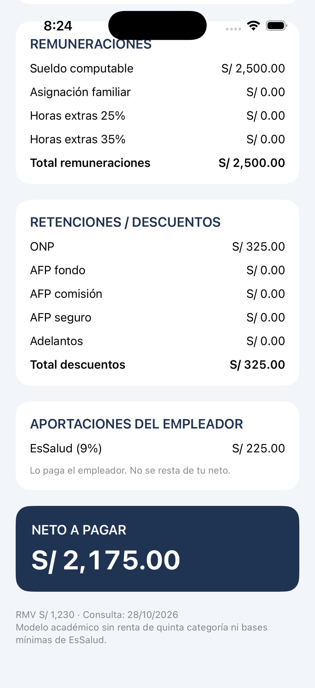
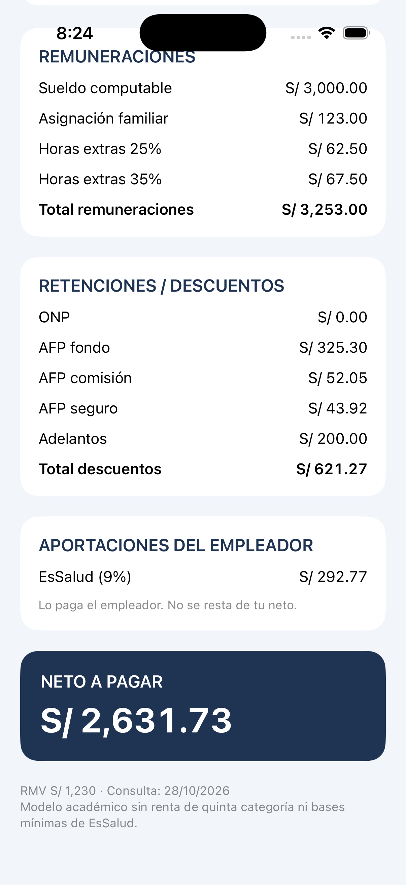
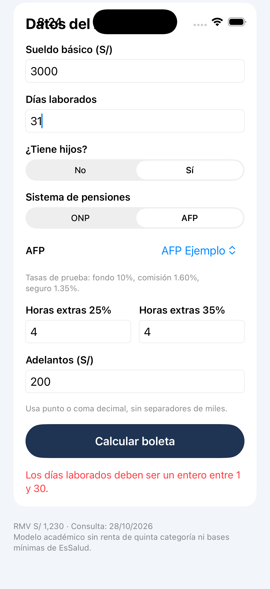

# Semana 09 · Boleta de pago: del sueldo al neto

App en **SwiftUI** de una sola pantalla que calcula una boleta de pago simplificada (formato del art. 19 del D.S. 001-98-TR), con un **Excel** que explica cada fórmula y sirve para validar la app. La idea es ver por qué el sueldo que se pacta con la empresa no es lo que llega al bolsillo.


**Niveles completados:** 1 (obligatorio) y 2.

## Entregables

| Entregable | Dónde está |
|---|---|
| Aplicación móvil (SwiftUI) | `BoletaPagoApp/` |
| Hoja de Excel (4 hojas) | `Excel/Boleta_Semana09.xlsx` |
| Respuestas a las preguntas de análisis | Abajo, en `docs/analisis.md` y en la hoja Explicación |
| Tabla de fuentes | Abajo, en `docs/fuentes.md` y en la hoja Explicación |
| Capturas | `docs/capturas/` |

## Capturas

| Caso 1 · ONP | Caso 3 · AFP, horas extras y adelanto | Validación |
|---|---|---|
|  |  |  |

La pantalla dice "Boleta de ejemplo". Arriba está el formulario y, al presionar **Calcular boleta**, aparece la boleta debajo con sus tres bloques (Remuneraciones, Retenciones / Descuentos y Aportaciones del empleador) y el neto. Los conceptos que no aplican salen en 0.00, como en una boleta real.

## Cómo ejecutar

1. Abrir `BoletaPagoApp/BoletaPagoApp.xcodeproj` en Xcode 16 o posterior.
2. Elegir un simulador con iOS 17 o posterior y presionar ▶️.
3. Para las pruebas, desde la carpeta `BoletaPagoApp`: `swift test` (son 13 pruebas).

## Qué hay en el repo

```
Semana09/
├── BoletaPagoApp/
│   ├── BoletaPagoApp/
│   │   ├── Configuration/Parametros.swift   RMV, tasas y diccionario de AFP (un solo lugar)
│   │   ├── Models/DatosBoleta.swift         structs: DatosBoleta, Concepto, ResultadoBoleta
│   │   ├── Models/FormularioBoleta.swift    lee y valida lo que se escribe en el formulario
│   │   ├── Services/Boleta.swift            clase Boleta: hace el cálculo
│   │   └── Views/ContentView.swift          la pantalla (formulario + boleta)
│   └── BoletaPagoAppTests/BoletaTests.swift pruebas de los casos 1 a 4, casos propios y validaciones
├── Excel/Boleta_Semana09.xlsx               hojas Parámetros, Boleta, Casos y Explicación
└── docs/
    ├── analisis.md                          respuestas completas a las 5 preguntas
    ├── fuentes.md                           tabla de fuentes
    └── capturas/                            capturas del simulador
```

## La app

**Controles usados:** solo los vistos en clase (`Text`, `VStack`, `HStack`, `@State`, `TextField`, `Picker`, `Button`) y `ScrollView` para que entren el formulario y la boleta.

| Dato | Control | Nivel | Validación |
|---|---|---|---|
| Sueldo básico | TextField con teclado decimal | 1 | Mayor que cero |
| Días laborados | TextField | 1 | Entero entre 1 y 30 |
| ¿Tiene hijos? | Picker (No / Sí) | 1 | — |
| Sistema de pensiones | Picker (ONP / AFP) | 1 | — |
| AFP | Picker | 2 | Solo aparece si eligió AFP |
| Horas extras 25% | TextField | 2 | Mayor o igual a cero |
| Horas extras 35% | TextField | 2 | Mayor o igual a cero |
| Adelantos | TextField | 2 | Mayor o igual a cero |

Si un dato no es válido, la app muestra un mensaje en rojo (por ejemplo "Los días laborados deben ser un entero entre 1 y 30.") y no calcula.

**Modelo separado de la pantalla:**
- **structs** para los datos: `DatosBoleta` (lo que ingresa el usuario), `Concepto` (nombre + monto) y `ResultadoBoleta`.
- **clase `Boleta`** con el método `calcular`, que arma la boleta.
- **diccionario** `Parametros.afps` con las tasas de cada AFP (fondo, comisión y seguro).
- **arrays** de `Concepto` para las remuneraciones, los descuentos y las aportaciones.

## Reglas de cálculo

| Concepto | Cómo se calcula |
|---|---|
| Sueldo computable | Sueldo básico ÷ 30 × días laborados |
| Asignación familiar | 10% de la RMV si tiene hijos (no se prorratea) |
| Valor hora | Sueldo básico ÷ 30 ÷ 8 |
| Horas extras 25% / 35% | Valor hora × 1.25 (o 1.35) × horas |
| Total remuneraciones | Suma de lo anterior |
| ONP | 13% del total de remuneraciones |
| AFP | Fondo + comisión + seguro sobre el total de remuneraciones |
| Adelantos | Se restan tal cual |
| Neto a pagar | Total remuneraciones − total descuentos |
| EsSalud | 9% del total de remuneraciones, lo paga el empleador |

Cada concepto se redondea a 2 decimales antes de sumar: `.centavos` en Swift y `ROUND` / `REDONDEAR` en Excel. No se calcula renta de 5.ª categoría ni se aplican bases mínimas de EsSalud.

## El Excel

| Hoja | Qué tiene |
|---|---|
| Parámetros | RMV, tasas y tabla de AFP, cada uno con su fuente y fecha. Las fórmulas los usan por nombre (`RMV`, `TASA_ONP`…), así ningún número va escrito dentro de una fórmula. |
| Boleta | Los mismos datos del formulario de la app y la boleta calculada con fórmulas visibles (sin valores pegados). Muestra los mismos mensajes de validación y las mismas notas que la app. |
| Casos | Los 4 casos, los 2 casos propios y un **registro libre** donde se copia cualquier caso que se ingrese en la app para compararlo al centavo. |
| Explicación | Cada fórmula en palabras con un ejemplo numérico, las 5 respuestas de análisis y la tabla de fuentes. |

## Control cruzado app vs. Excel

Comparamos 4 importes por caso (total remuneraciones, total descuentos, neto y EsSalud). Los valores de la app salen de las pruebas de `BoletaTests.swift`.

| Caso | Datos | Neto Excel | Neto app | EsSalud | ¿Coincide? |
|---|---|---:|---:|---:|---|
| 1 | S/ 2,500 · 30 días · sin hijos · ONP | 2,175.00 | 2,175.00 | 225.00 | Sí |
| 2 | S/ 1,800 · 27 días · con hijos · ONP | 1,516.41 | 1,516.41 | 156.87 | Sí |
| 3 | S/ 3,000 · 30 días · con hijos · AFP Ejemplo · 4 h + 4 h · adelanto 200 | 2,631.73 | 2,631.73 | 292.77 | Sí |
| 4 | S/ 4,200 · 24 días · con hijos · AFP Ejemplo · 2 h + 2 h · adelanto 100 | 3,011.17 | 3,011.17 | 321.66 | Sí |
| Propio 1 (mi caso propio) | S/ 2,300 · ONP | 2,001.00 | 2,001.00 | 207.00 | Sí |
| Propio 2 (segundo sueldo real) | S/ 2,500 · AFP Habitat | 2,179.00 | 2,179.00 | 225.00 | Sí |

No hubo diferencias. Lo que más cuidamos fue el redondeo: cada concepto se redondea antes de sumar (por ejemplo, en el caso 3 la comisión es 52.048 → 52.05 y el seguro 43.9155 → 43.92), igual en la app y en el Excel.

## Preguntas de análisis

Respuestas completas en [`docs/analisis.md`](docs/analisis.md).

1. **ONP o AFP (caso 3):** con AFP Ejemplo el neto es S/ 2,631.73 y con ONP es S/ 2,630.11, o sea la AFP deja S/ 1.62 más. No basta comparar porcentajes: el 10% de la AFP es ahorro propio, mientras que en la ONP el 13% va a un fondo común y se necesitan 20 años de aportes para tener pensión. Además, la comisión cambia según la AFP.
2. **Costo para la empresa (caso 3):** S/ 3,253.00 + S/ 292.77 de EsSalud = **S/ 3,545.77**. De eso, al trabajador le llega como neto el **74.22%**.
3. **Días laborados (caso 2):** con 30 días el bruto sube S/ 180, pero el neto sube solo **S/ 156.60**, porque de esos S/ 180 se descuenta 13% de ONP. La asignación familiar no cambia.
4. **Horas extras (caso 3):** S/ 130 de S/ 3,253 = **4.00%** del total de remuneraciones.
5. **Con datos reales:** con S/ 2,300 en ONP llega el 87.00% y con S/ 2,500 en AFP Habitat el 87.16%. Casi igual, porque los descuentos son porcentajes fijos del bruto. La comparación con dos compañeros está en `docs/analisis.md`.

## Fuentes

Fecha de consulta: **28/10/2026**.

| Dato | Valor | Fuente |
|---|---|---|
| RMV | S/ 1,230.00 (desde el 01/10/2026) | [D.S. N.° 015-2026-TR, El Peruano](https://busquedas.elperuano.pe/dispositivo/EX/2559163-1) |
| Asignación familiar | 10% de la RMV = S/ 123.00 | Ley 25129 |
| ONP | 13% | D.L. 19990 |
| EsSalud | 9% | Ley 26790 |
| Horas extras | 25% las primeras, 35% las siguientes | D.S. 007-2002-TR |
| AFP (fondo, comisión sobre flujo, seguro) | 10% · Habitat 1.47%, Integra 1.55%, Prima 1.60%, Profuturo 1.69% · seguro 1.37% | [SBS, devengue octubre 2026](https://www.sbs.gob.pe/app/spp/empleadores/comisiones_spp/paginas/comision_prima.aspx) |
| AFP Ejemplo | 10% · 1.60% · 1.35% | Valores de prueba del enunciado |
| Sueldo Propio 1 | S/ 2,300 | [Indeed – ASO Developer Junior, LYNXUS Solutions](https://pe.indeed.com/viewjob?jk=2e0bc9e6cc00ba32) |
| Sueldo Propio 2 | S/ 2,500 | [Indeed – Modelador BIM de Estructuras, Typsa Perú](https://pe.indeed.com/viewjob?jk=a77b5ea411c2291e) |

Tabla completa en [`docs/fuentes.md`](docs/fuentes.md). Los trabajadores y empresas de la boleta son ficticios; no se usan DNI ni RUC reales.

## Hitos (un commit por hito)

1. `inicio: estructura del proyecto SwiftUI`
2. `config: parametros y fuentes`
3. `modelo: remuneraciones, descuentos y neto`
4. `caso 1 verificado` / `caso 2 verificado`
5. `ui: formulario y boleta`
6. `nivel 2: AFP, horas extras y adelantos (casos 3 y 4 verificados)`
7. `excel: parametros, boleta, casos y explicacion`
8. `analisis: respuestas y casos propios`
9. `docs: README con capturas`
